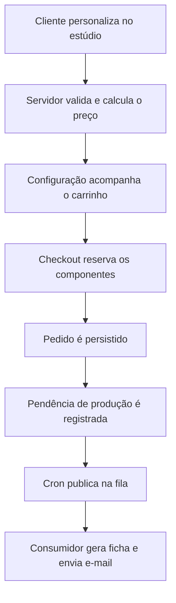

<div align="center">

# Ateliê Nuvem — Projeto Magento


[](https://github.com/gustavodanjos/entrega-final-magento/actions/workflows/quality.yml)

> Uma loja em que a cliente cria seu tênis, acompanha a personalização em tempo real e compra uma combinação que a fábrica consegue produzir.

Projeto final do Programa de Estágio Webjump em Magento 2.

</div>

---

## Índice

- [Sobre o projeto](#sobre-o-projeto)
- [Funcionalidades](#funcionalidades)
- [Stack de tecnologia](#stack-de-tecnologia)
- [Arquitetura](#arquitetura)
- [Como executar](#como-executar)
- [Testes e qualidade](#testes-e-qualidade)
- [Decisões técnicas e visuais](#decisões-técnicas-e-visuais)
- [Escopo e limitações](#escopo-e-limitações)
- [Padrões e colaboração](#padrões-e-colaboração)
- [Documentação técnica](#documentação-técnica)
- [Equipe](#equipe)

## Sobre o projeto

O **Ateliê Nuvem** foi desenvolvido para a **Nuvem Calçados**, uma marca fictícia de Franca/SP, como desafio final do programa de estágio. O trabalho foi organizado na Sprint 9, durante as semanas 18 e 19.

O briefing apresenta uma fábrica que recebe personalizações por WhatsApp, calcula preços manualmente e controla peças em caderno. A proposta transforma esse processo em uma experiência integrada: a cliente escolhe as peças do tênis, o sistema valida as combinações e calcula o preço, e a fábrica recebe os dados necessários para a produção.

O desenvolvimento partiu de um briefing, de um manual de marca e de mockups fornecidos. A equipe integrou cinco frentes em um mesmo repositório, com contratos compartilhados entre os módulos.

## Funcionalidades

| Jornada | Recursos |
| :--- | :--- |
| **Personalizar** | Estúdio com preview SVG em camadas, escolha de componentes, tamanho e gravação conforme o modelo, preço atualizado e explicações para combinações bloqueadas. |
| **Comprar** | Tipo de produto `atelie`, validação no servidor, configuração no carrinho e nos documentos de venda, edição e recompra. |
| **Controlar estoque** | Disponibilidade por componente, reserva transacional na finalização, registro de movimentações e devolução por cancelamento ou reembolso aplicável. |
| **Produzir** | Administração de componentes e regras, permissões para a fábrica, fichas de produção e processamento assíncrono por fila. |
| **Compartilhar** | Criações salvas na conta, publicação de criações, galeria e vitrine com Page Builder. |
| **Integrar** | Operações GraphQL para catálogo, disponibilidade, validação e adição ao carrinho; REST para disponibilidade e integração da configuração ao carrinho Magento. |

O catálogo inicial do kit contém **dois modelos, sete grupos, 31 componentes e cinco regras de fabricação**. Os dados de referência ficam em [`kit/dados/`](kit/dados/).

## Stack de tecnologia

| Camada | Tecnologia |
| :--- | :--- |
| Plataforma | Magento Open Source **2.4.8** |
| Backend | PHP **8.4**, Composer e serviços Magento |
| Frontend | Tema `Nuvem/pastel`, herdado do Luma; LESS, RequireJS e Knockout |
| Conteúdo | CMS e Page Builder |
| APIs | REST e GraphQL |
| Banco de dados | MariaDB **11.4** |
| Busca | OpenSearch, imagem `markoshust/magento-opensearch:3-0` |
| Cache | Valkey **8.1** |
| Mensageria | RabbitMQ, imagem `markoshust/magento-rabbitmq:4.2-0` |
| Servidor web | Nginx, imagem `markoshust/magento-nginx:1.28-0` |
| Ambiente | Docker e Docker Compose, com scripts do docker-magento |
| Qualidade | PHPUnit, PHPCS com padrão Magento2 e GitHub Actions |

As versões do Magento estão fixadas em `src/composer.json` e `src/composer.lock`. As imagens dos serviços são definidas em `compose.versions.yaml`.

## Arquitetura

O projeto divide as responsabilidades em seis módulos que compartilham a mesma instalação Magento.

| Módulo | Responsabilidade |
| :--- | :--- |
| `Nuvem_Atelie` | Catálogo de componentes, regras, validação, contratos e tipo de produto. |
| `Nuvem_AtelieSales` | Preço, estoque, carrinho, pedidos e apresentação da configuração nos documentos. |
| `Nuvem_AtelieStudio` | Estúdio de personalização e geração de previews. |
| `Nuvem_AtelieAdmin` | Administração, permissões, produção, fila e cache do catálogo. |
| `Nuvem_AtelieVitrine` | Criações salvas, galeria, widgets e conteúdo da loja. |
| `Nuvem_AtelieGraphQl` | Schema e resolvers para integrações GraphQL. |

```text
entrega-final-magento/
├── src/
│   ├── app/code/Nuvem/                 # Seis módulos do projeto
│   └── app/design/frontend/Nuvem/pastel/ # Tema da loja
├── bin/                               # Comandos do ambiente Docker
├── compose/                           # Suporte à configuração dos serviços
├── docs/                              # Contratos e documentação técnica
├── kit/                               # Dados, marca, SVGs e prova de API
└── .github/workflows/                  # Automação de qualidade
```

### Fluxo de compra e produção



O estoque é disputado na finalização da compra. Adicionar um tênis ao carrinho não reserva suas peças. Se a compra falhar, o tratamento transacional considera a etapa da falha para preservar o saldo e os pedidos já persistidos.

## Como executar

### Pré-requisitos

- Git, Docker e Docker Compose.
- Chaves pública e privada do Magento Marketplace para instalar dependências pelo Composer.
- Portas dos serviços disponíveis e memória para executar o ambiente; recomenda-se reservar pelo menos 6 GB para o Docker.
- No Windows com WSL2, repositório dentro do sistema de arquivos Linux.

### 1. Clonar e iniciar o ambiente

```bash
git clone https://github.com/gustavodanjos/entrega-final-magento.git
cd entrega-final-magento
bin/start --no-dev
bin/copytocontainer --all
```

O modo `--no-dev` é usado na primeira inicialização para permitir a cópia inicial dos arquivos aos containers.

### 2. Instalar dependências e o Magento

```bash
bin/composer install
bin/setup final-project.test
```

Configure as chaves do Marketplace quando solicitado pelo Composer. Não versione `src/auth.json` nem `src/app/etc/env.php`.

O setup pode solicitar permissão para configurar o domínio local. Caso necessário, adicione ao arquivo de hosts:

```text
127.0.0.1 final-project.test
```

No WSL2, configure também o arquivo de hosts do Windows se o navegador estiver sendo executado nele.

### 3. Preparar os dados e acessar

Os módulos usam data patches para criar dados e configurações do Ateliê durante a instalação e os upgrades. Para carregar também os Sample Data do Magento declarados no Composer:

```bash
bin/magento sampledata:deploy
bin/magento setup:upgrade
bin/magento indexer:reindex
bin/magento cache:flush
```

| Acesso local | Endereço / credencial padrão |
| :--- | :--- |
| Loja | https://final-project.test |
| Administração | https://final-project.test/admin |
| Usuário | `john.smith` |
| Senha | `password123` |

As credenciais são os padrões locais de `env/magento.env` e podem ser alteradas na configuração do ambiente.

### 4. Processar a produção

A geração das fichas depende do cron e do consumidor de mensagens. Consulte os consumidores disponíveis e inicie o correspondente à produção:

```bash
bin/magento queue:consumers:list
bin/magento queue:consumers:start nuvem.atelie.production
```

O consumidor permanece em execução. Para disparar uma rodada do cron manualmente em desenvolvimento:

```bash
bin/magento cron:run
```

### Comandos do dia a dia

```bash
bin/start
bin/stop
bin/magento cache:flush
bin/docker-compose ps
bin/docker-compose logs --tail=100
```

Após atualizar a branch, execute `bin/composer install` se as dependências mudaram, `bin/magento setup:upgrade` para atualizações de módulos e `bin/magento app:config:import` quando houver alterações aplicáveis em `config.php`.

Se a loja retornar 502/500 ao iniciar, confira os logs e aguarde os serviços de banco e busca ficarem disponíveis. Se o domínio não abrir, confira o arquivo de hosts. Evite `bin/removeall` no uso diário: ele pode apagar os dados locais.

## Testes e qualidade

Com as dependências instaladas e os arquivos sincronizados no container, execute na raiz do repositório:

```bash
# Testes PHPUnit
bin/clinotty vendor/bin/phpunit -c phpunit.xml.dist

# Padrão de código Magento2
bin/clinotty vendor/bin/phpcs app/code/Nuvem
```

O [workflow Quality](.github/workflows/quality.yml) executa PHPCS e PHPUnit. Há também testes JavaScript e cenários de integração no repositório; eles não são etapas explícitas desse workflow.

A prova de API possui etapas de REST, GraphQL, concorrência e carga. As instruções e dependências estão no [kit](kit/README.md). Os cenários de estoque alteram dados: prepare um **banco isolado**, seguindo o [roteiro de integração](src/app/code/Nuvem/AtelieSales/Test/Integration/README.md), antes de executar a corrida.

### Evidência histórica de concorrência

Na execução HTTP registrada em **23/10/2026**, na revisão `39eaf42`, **40 tentativas para dez unidades produziram dez pedidos e 30 recusas por estoque, sem respostas 5xx**. O relatório também registra a conciliação do estoque com as movimentações.

Esse resultado pertence à execução documentada e não representa uma nova validação da versão atual. Consulte a [evidência e o procedimento de reprodução](src/app/code/Nuvem/AtelieSales/Test/Integration/README.md#evidence--2026-10-23).

## Decisões técnicas e visuais

- **Tipo de produto próprio:** integra configuração e regras de fabricação ao ciclo de compra. As peças são componentes da fábrica, sem exigir um produto Magento independente para cada peça ou combinação.
- **Servidor como autoridade:** o navegador oferece resposta imediata para preço e restrições; a compra passa pela validação e pelo cálculo do backend.
- **Estoque por componente:** atualizações condicionais, transações e registro de movimentações tratam concorrência e falhas do checkout.
- **Produção assíncrona:** uma outbox registra a pendência antes da publicação na fila, permitindo retomar o processamento. A ficha é identificada por item de pedido.
- **Cache conforme o dado:** catálogo compartilhado usa tags de invalidação, informações da cliente usam customer data e disponibilidade é consultada separadamente, sem cache da resposta.
- **Identidade a partir do material fornecido:** o tema usa os mockups e o manual de marca como referência, com tokens em LESS e fontes Quicksand e Nunito locais. O preview usa SVG em camadas para representar as escolhas.

## Escopo e limitações

| Ponto | Situação |
| :--- | :--- |
| Pagamento e frete | Demonstração com Check/Money Order e Flat Rate, conforme o briefing. |
| Ambiente | Execução local com Docker; infraestrutura de produção não faz parte da entrega. |
| Personalização visual | Preview SVG; 3D, realidade aumentada e upload de imagens ficaram fora do escopo. |
| Produção e e-mail | Exigem cron, consumidor e transporte de e-mail configurados. O controle de envio não garante entrega exatamente uma vez em toda falha possível. |
| REST previsto no backlog | As rotas `/V1/atelie/configurador/:sku` e `/V1/atelie/validar` não foram localizadas na versão consultada. O GraphQL oferece operações correspondentes. |
| Fontes do preview | O tema possui fontes locais, mas o SVG gerado no servidor contém referência ao Google Fonts. |
| Validação | Não se atribuem à versão atual resultados de instalação limpa, cobertura, Lighthouse ou prova final sem uma execução correspondente. |

## Padrões e colaboração

O trabalho foi dividido em cinco frentes, com fundação e contratos compartilhados. Cada tarefa segue em uma branch própria e passa por Pull Request com revisão de outra frente.

Código, nomes de arquivos e mensagens de commit usam inglês. A documentação pode ser escrita em português. As diretrizes incluem KISS, DRY, YAGNI e separação entre apresentação, serviços de negócio e persistência.

```text
# Branch
<type>/<task-id>-<short-description-in-english>

# Commit
<type>(<optional scope>): <short description in English>
```

Exemplos:

```text
feat/f2.3-component-stock-reservation
feat(sales): reserve components during checkout
docs: document project architecture
```

Os tipos usados incluem `feat`, `fix`, `docs`, `refactor`, `test`, `chore` e `style`. O código personalizado fica em `src/app/code/Nuvem/` e `src/app/design/frontend/Nuvem/`. Dependências e configurações compartilhadas são versionadas; credenciais e dados privados do ambiente ficam fora do Git.

## Documentação técnica

- [Kit, dados e prova de API](kit/README.md)
- [Contrato do estúdio](docs/contrato-estudio.md)
- [Integração de preço](docs/contrato-integracao-preco.md)
- [Devolução de estoque](docs/f2.4-stock-returns.md)
- [Disponibilidade pública](docs/f2.5-public-availability.md)
- [Criações salvas](docs/f5.1-saved-creations.md)
- [Integração e concorrência de estoque](src/app/code/Nuvem/AtelieSales/Test/Integration/README.md)

## Equipe

| Integrante | Frente principal | GitHub |
| :--- | :--- | :--- |
| Samuel | Frente 1 — Núcleo, regras e tipo de produto | [@samuelcosta-pd](https://github.com/samuelcosta-pd) |
| Gustavo | Frente 2 — Preço, estoque e pedido | [@gustavodanjos](https://github.com/gustavodanjos) |
| Jhonatan | Frente 3 — Estúdio | [@jhonatanLobo](https://github.com/jhonatanLobo) |
| Antonni | Frente 4 — Administração e produção | [@AntonniSMoraes](https://github.com/AntonniSMoraes) |
| Emiliano | Frente 5 — Vitrine e integrações | [@Emiliano-Souza](https://github.com/Emiliano-Souza) |

A Frente 0, responsável pela base do projeto, ambiente e contratos, é compartilhada pela equipe.
